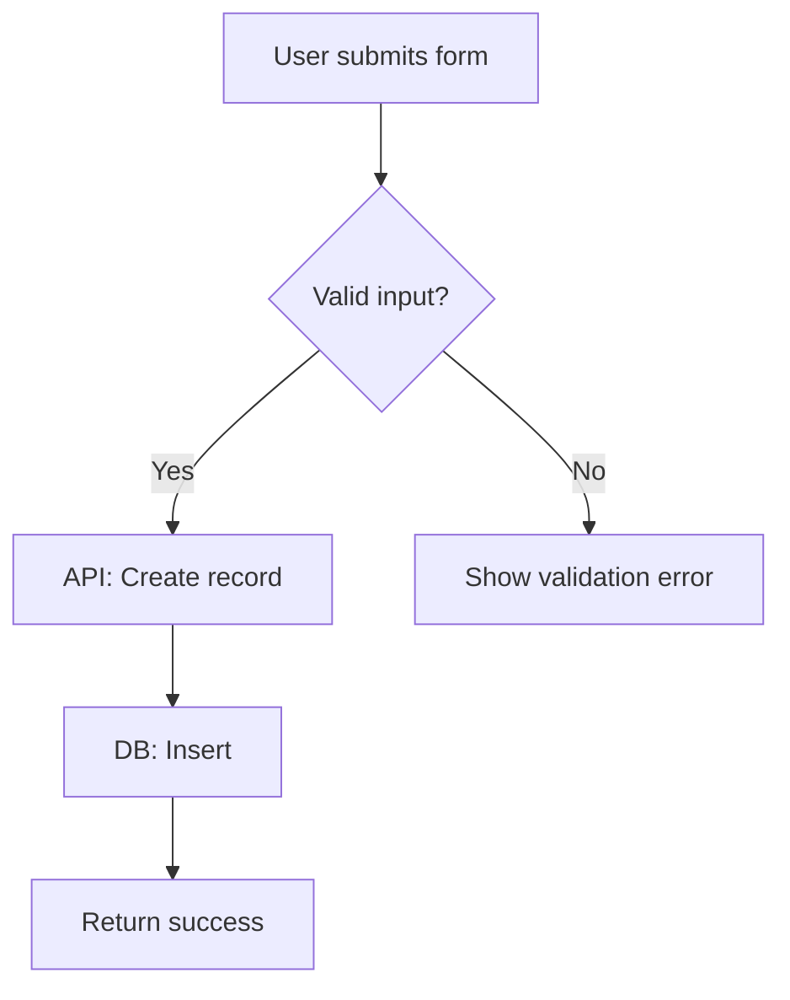
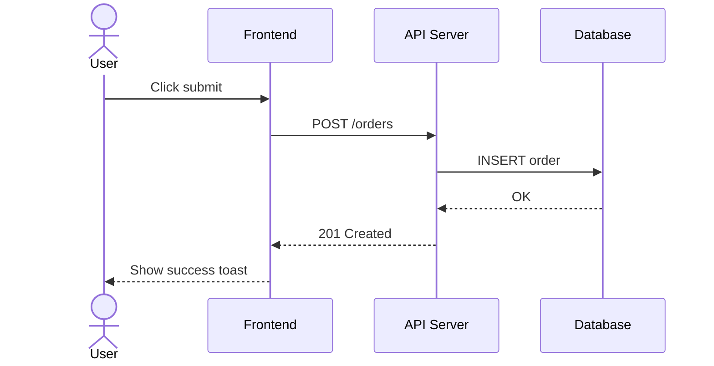
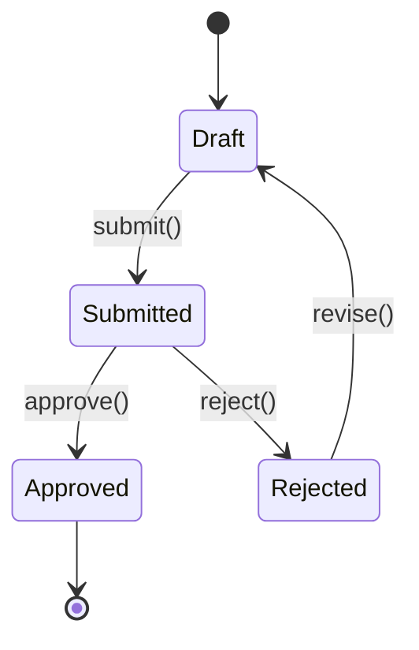

# Workflow — SKILL

## Overview
Mermaid-based diagramming for flowcharts, sequence diagrams, and state machines.
Visual documentation for system architecture and feature flows. Mermaid 11+ syntax.

## Setup / Base Project
```bash
# Mermaid CLI (optional — for local rendering to SVG/PNG)
npm install -g @mermaid-js/mermaid-cli
mmdc -i diagram.mmd -o diagram.svg
# GitHub/GitLab render Mermaid natively in .md fenced blocks
```

## Core Concepts
- **Flowchart**: process flow with decisions — `flowchart TD` (top-down) or `LR` (left-right)
- **Sequence diagram**: API call flow between actors — `sequenceDiagram`
- **State diagram**: status transitions — `stateDiagram-v2`
- **Subgraph**: group related nodes by layer (Frontend / API / DB)
- **Output location**: `.workspace/workflow/` directory
- **One diagram per concern** — overview, feature flow, and sequence are separate files

## Common Patterns




## Gotchas
- Keep diagrams focused — one diagram per concern, not everything in one file
- Use `subgraph` to separate layers (FE/API/DB) in system overviews
- Mermaid syntax is whitespace-sensitive — watch indentation in markdown code blocks
- Test rendering in GitHub preview before committing complex diagrams
- Always include both happy path and error path in feature flows
- Use `note right of` / `note over` in sequence diagrams for clarification

## References
- https://mermaid.js.org/intro/
- https://mermaid.js.org/syntax/flowchart.html
- https://mermaid.js.org/syntax/sequenceDiagram.html
- https://mermaid.js.org/syntax/stateDiagram.html
