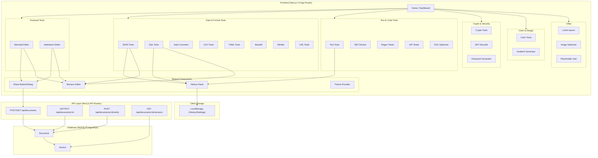
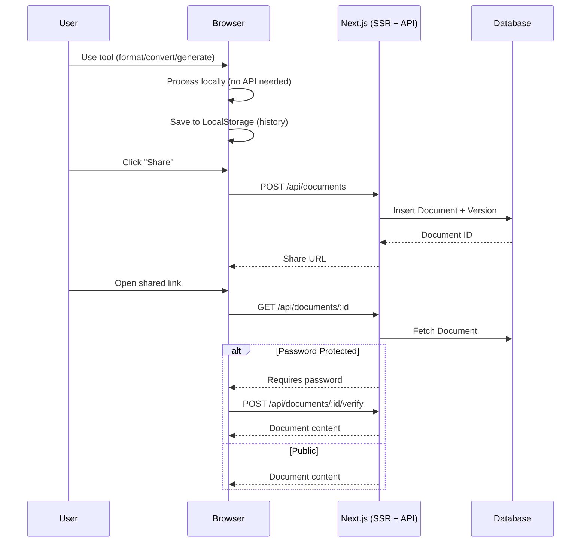

# DevTools Utility — System Overview

> Updated: 2026-03-31

## Architecture

## Tech Stack

| Layer | Technology |
|-------|-----------|
| Framework | Next.js 14.2.15 (App Router) |
| Language | TypeScript 5.6.3 |
| UI | Tailwind CSS + Radix UI + shadcn/ui |
| Editor | Monaco Editor |
| Database | MySQL / PostgreSQL via Prisma 5.22 |
| Diagrams | Mermaid 11.3 |
| Auth (Docs) | bcryptjs (password-protected sharing) |
| Deploy | PM2 process manager |
| Domain | util.commsk.dev |

## Data Flow

## Module Count: 25 Tools

| Category | Tools | Count |
|----------|-------|-------|
| Featured | Mermaid, Markdown | 2 |
| Data & Format | JSON, SQL, Converter, CSV, YAML, Base64, Minify, URL | 8 |
| Text & Code | Text, Diff, Regex, API Tester, SVG | 5 |
| Crypto & Security | Crypto, JWT, Password | 3 |
| Color & Design | Color, Gradient | 2 |
| Utility | Lorem Ipsum, Image, Placeholder | 3 |
| Share/View | Share page | 1 |
| **Total** | | **24 + 1 (home)** |
